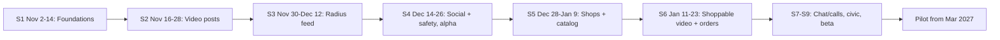

# MyLocal Backlog: Sprints 1–6 (plus outline for 7–9)

> [!NOTE]
> **Cadence:** 2-week sprints, Mon–Sat, 3 hrs/day → **36 h capacity per sprint**. Each sprint plans **~33 h**, leaving ~3 h for planning, demo/retro and bug fixes.
> **Priority:** P0 = sprint fails without it · P1 = should do · P2 = only if time is left.
> **Labels:** 🤖 = an AI agent can do most of it from the spec · 🧠 = needs your judgement (security, money, design, real-world work).
> Import-ready CSV: [mylocal_backlog.csv](file:///Users/Swapnil/Documents/Something%20local/backlog/mylocal_backlog.csv)

## Sprint Map

| Sprint | Dates | Goal | Planned |
| :--- | :--- | :--- | ---: |
| **S1** | Nov 2 – Nov 14 | Install the app, log in with OTP, set your home locality | 33 h |
| **S2** | Nov 16 – Nov 28 | Record or upload a short and watch it in a nearby feed | 33 h |
| **S3** | Nov 30 – Dec 12 | Radius feed (1 km / 3 km / City / Global) with automatic local-to-global promotion | 33 h |
| **S4** | Dec 14 – Dec 26 | Profiles, follows, comments, moderation, push. **Closed alpha with 20 friends** | 33 h |
| **S5** | Dec 28 – Jan 9 | Shops set up storefronts and catalogs; users find nearby shops | 33 h |
| **S6** | Jan 11 – Jan 23 | Tap "Order Now" on a short → pay by UPI/COD → shop gets the order | 33 h |

---

## Sprint 1: Foundations (Nov 2 – Nov 14)
**Sprint goal:** A new user installs a dev build, logs in with phone OTP and saves a home locality.
**Demo:** Fresh install on a low-end Android phone → OTP → name/avatar → locality pin saved → shows "Welcome to Kothrud" (or similar).

| ID | Epic | Item | Type | Est (h) | Pri | Acceptance criteria |
| :--- | :--- | :--- | :--- | ---: | :--- | :--- |
| ML-001 | Foundations | Repo setup: Expo (TypeScript) app, `supabase/` folder, ESLint/Prettier, `AGENTS.md` coding rules for AI agents 🤖 | Chore | 3 | P0 | • `npx expo start` runs on Android • Lint + typecheck pass • AGENTS.md covers stack, folder layout, naming, "always write tests" |
| ML-002 | Foundations | CI/CD: GitHub Actions (lint, typecheck, test) + EAS build profiles (dev/preview/prod) + OTA update channel 🤖 | Chore | 3 | P0 | • PRs blocked on failing checks • `eas build --profile preview` produces an APK • OTA update reaches the installed preview build |
| ML-003 | Foundations | Supabase dev + prod projects, PostGIS enabled, migration workflow, seed script 🤖 | Task | 2 | P0 | • `supabase db push` applies migrations • PostGIS `ST_DWithin` query works • Secrets kept out of git |
| ML-004 | Foundations | Design system v0: saffron/navy theme, type scale, Button, Card, Input, Avatar, BottomSheet, Toast 🤖 | Story | 4 | P0 | • Components in a `/ui` folder with a demo screen • Text renders Hindi (Devanagari) correctly • Touch targets ≥ 44 px |
| ML-005 | Identity | Phone OTP login (Supabase Auth + MSG91/WhatsApp OTP provider), persistent session, logout 🧠 | Story | 4 | P0 | • OTP arrives in < 30 s • Wrong OTP shows an error, resend after 30 s • Session survives app restart • OTP requests rate-limited per number |
| ML-006 | Identity | Onboarding: name, avatar, language (English/Hindi), profile type (Person / Shop / Creator) 🤖 | Story | 3 | P0 | • Avatar compressed to ≤ 200 KB • Choices saved to `profiles` • Can skip avatar |
| ML-007 | Identity | Home locality: GPS permission, reverse geocode (Ola Maps/OSM), drag pin to adjust, save as `geography(Point)` + locality name 🧠 | Story | 5 | P0 | • Works when GPS is denied (search by area name) • Exact point stored privately; public location blurred to ~200 m • Locality name shown on the home header |
| ML-008 | Foundations | Data model v1: `profiles`, `localities`, `posts`, `follows` + Row Level Security policies + ERD doc 🧠 | Task | 4 | P0 | • RLS on every table (users edit only their own rows) • GIST index on location columns • ERD in `docs/data-model.md` |
| ML-009 | Analytics | Sentry + PostHog, first events: `signup_started`, `signup_completed`, `locality_set` 🤖 | Chore | 2 | P1 | • A test crash appears in Sentry • Funnel visible in PostHog |
| ML-010 | Business | Apply for cloud credits (Google for Startups, AWS Activate, Microsoft Founders Hub), start company + DPIIT registration, create Play Console account 🧠 | Biz | 3 | P1 | • 3 applications submitted • Play Console verified |

---

## Sprint 2: Video & Posts (Nov 16 – Nov 28)
**Sprint goal:** Users record or upload a short (≤ 60 s), it gets transcoded, and it plays in a swipeable nearby feed.
**Demo:** Record a 20 s clip → upload with a progress bar → it appears in the feed of a second phone 2 km away.

| ID | Epic | Item | Type | Est (h) | Pri | Acceptance criteria |
| :--- | :--- | :--- | :--- | ---: | :--- | :--- |
| ML-011 | Video | Spike: compare Bunny Stream and Cloudflare Stream (upload API, 720p cost, playback on a low-end Android) → write a decision record 🧠 | Spike | 2 | P0 | • `docs/adr/001-video.md` with cost per 1,000 views and the decision |
| ML-012 | Video | Capture or pick a short: record ≤ 60 s or choose from gallery, trim, pick cover frame 🤖 | Story | 5 | P0 | • Rejects > 60 s or > 200 MB • Trim preview plays • Works on Android 10+ |
| ML-013 | Video | Resumable upload via signed URL from an Edge Function, progress bar, retry on network drop 🤖 | Story | 5 | P0 | • Upload survives toggling airplane mode • Signed URL expires in 1 hour • Upload key never shipped in the app |
| ML-014 | Video | Transcode webhook → Edge Function marks post `processing → ready`, saves thumbnail + HLS URL 🤖 | Task | 3 | P0 | • Webhook signature checked • Failed transcode → post `failed` + user notified |
| ML-015 | Posts | Create post: caption, hashtags, category (Talent / Food / Shop / News / Civic), location tag (home or current) 🤖 | Story | 3 | P0 | • Caption ≤ 500 chars • Hashtags parsed into a table • Post saved with a location point |
| ML-016 | Feed | Full-screen vertical player: swipe, autoplay, preload next 2, mute toggle, 720p cap, data-saver (480p) 🧠 | Story | 6 | P0 | • Next video starts in < 1 s on 4G • No memory growth after 50 swipes • Data-saver setting respected |
| ML-017 | Posts | Photo and text posts (image compression, Supabase Storage) 🤖 | Story | 3 | P1 | • Images ≤ 300 KB after compression • Mixed feed renders photo cards |
| ML-018 | Feed | Basic nearby feed: posts within 5 km, newest first, cursor pagination (temporary, replaced by ranking in S3) 🤖 | Story | 3 | P0 | • Only `ready` posts shown • Smooth infinite scroll |
| ML-019 | Business | Interview 10 shopkeepers + 10 residents in the target area; record pains and willingness to pay 🧠 | Biz | 3 | P0 | • Notes in `docs/research/interviews.md` • Top 5 insights listed |

---

## Sprint 3: Elastic Radius Feed + Escalator (Nov 30 – Dec 12)
**Sprint goal:** Users switch between 1 km / 3 km / City / Global, and popular local posts automatically climb to wider tiers.
**Demo:** A seeded post with high local engagement gets promoted to the City feed within 15 minutes, and its creator gets a "Your post went city-wide" notification.

| ID | Epic | Item | Type | Est (h) | Pri | Acceptance criteria |
| :--- | :--- | :--- | :--- | ---: | :--- | :--- |
| ML-020 | Feed | Radius switcher UI: 1 km / 3 km / City / Global, saved per user 🤖 | Story | 3 | P0 | • Switching reloads the feed in < 500 ms (cached) • Last choice remembered |
| ML-021 | Feed | Ranking function v1 (Postgres RPC): engagement velocity × distance decay × freshness, filtered by tier 🧠 | Task | 6 | P0 | • Weights in a config table (no redeploy to tune) • Unit tests with fixed fixtures • Explain-plan uses indexes |
| ML-022 | Feed | Engagement tracking: view (≥ 3 s), watch time, likes, shares; batched writes into aggregate table 🤖 | Task | 4 | P0 | • Client batches events every 10 s • Duplicate views from one user within 1 h ignored |
| ML-023 | Feed | Escalation job (`pg_cron`, every 15 min): promote posts to City / State / Global when they beat locality percentile thresholds 🧠 | Task | 5 | P0 | • Thresholds configurable • Promotion history logged • Minimum view count stops tiny-sample flukes |
| ML-024 | Feed | "Trending near you" badge + creator notification when a post is promoted 🤖 | Story | 2 | P1 | • Badge shows tier reached • One notification per tier step |
| ML-025 | Feed | Cold-start blending: if local inventory < 20 posts, fill with City/Global content, clearly labelled 🤖 | Story | 3 | P0 | • Feed never shows "empty" • Labels "From your city" / "Global" visible |
| ML-026 | Feed | Locality & hashtag pages (tap locality name → that area's feed; tap #tag → tagged posts) 🤖 | Story | 3 | P1 | • Deep-linkable URLs • Paginated |
| ML-027 | Foundations | Synthetic seed data: 5 localities, 500 users, 20k posts for dev/testing 🤖 | Chore | 2 | P0 | • `npm run seed` is repeatable • Never runs against prod |
| ML-028 | Feed | Performance test: feed RPC on 100k posts, p95 < 300 ms 🧠 | Task | 3 | P1 | • Results in `docs/perf.md` • Indexes added for any slow paths |
| ML-029 | Business | Choose the pilot locality: draw the 3 km boundary and list 100 target shops with category and contact 🧠 | Biz | 2 | P0 | • Boundary saved as GeoJSON • Shop list in a sheet |

---

## Sprint 4: Social Graph, Safety & Alpha (Dec 14 – Dec 26)
**Sprint goal:** A safe, usable social app. Ship a **closed alpha to 20 friends/neighbours** via Play internal testing.
**Demo:** A tester follows someone, comments, shares to WhatsApp; an offensive test post is auto-hidden; the reporter sees it removed.

| ID | Epic | Item | Type | Est (h) | Pri | Acceptance criteria |
| :--- | :--- | :--- | :--- | ---: | :--- | :--- |
| ML-030 | Social | Profile page: post grid, bio, locality, follower/following counts, edit profile 🤖 | Story | 4 | P0 | • Own vs others' view • Counts update in real time |
| ML-031 | Social | Follow / unfollow + "Following" feed tab 🤖 | Story | 3 | P0 | • Can't follow yourself • Following feed paginates |
| ML-032 | Social | Comments: one level of replies, like a comment, delete own comment 🤖 | Story | 4 | P0 | • Comment count consistent • Deleted comments show "removed" |
| ML-033 | Growth | Share to WhatsApp with a deep link + web fallback page with preview image (OG tags) 🤖 | Story | 3 | P0 | • Link opens the app if installed, else Play Store / web preview • Preview shows thumbnail + caption |
| ML-034 | Trust & Safety | AI moderation: on post ready, check caption + 3 sampled frames; auto-hide high risk, queue medium risk 🧠 | Task | 5 | P0 | • Decision + reason stored • Under 60 s per post • Creator can appeal |
| ML-035 | Trust & Safety | Report & block + admin review queue (Expo web, admin role only) 🧠 | Story | 4 | P0 | • Report reasons list • Blocked users disappear from feed and comments • Admin page protected by role |
| ML-036 | Notifications | Push notifications via Expo/FCM: like, comment, follow, promotion; per-type on/off settings 🤖 | Story | 4 | P0 | • Tapping a notification opens the right screen • Quiet hours 10 PM – 8 AM by default |
| ML-037 | Trust & Safety | Rate limits & anti-spam: posts/day, comments/min, tighter limits for new accounts 🤖 | Task | 2 | P0 | • Limits in config • Friendly error message |
| ML-038 | Compliance | Privacy policy, terms, community guidelines, grievance officer page (AI-drafted, reviewed by you) 🧠 | Chore | 2 | P0 | • Linked in app settings and Play listing • DPDP consent text for location |
| ML-039 | Release | Alpha release on Play internal testing for 20 testers + in-app feedback form 🧠 | Release | 2 | P0 | • 20 installs • Feedback collected in a sheet |

---

## Sprint 5: Shops & Catalog (Dec 28 – Jan 9)
**Sprint goal:** Local shops create a verified storefront with products; users browse nearby shops on a map.
**Demo:** A real shop owner sets up their store in < 10 min with your help and adds 10 products, half of them via photo auto-fill.

| ID | Epic | Item | Type | Est (h) | Pri | Acceptance criteria |
| :--- | :--- | :--- | :--- | ---: | :--- | :--- |
| ML-040 | Shops | Shop onboarding: name, category, address pin, hours, phone, UPI ID, FSSAI no. (food), delivery options (self / pickup / platform), minimum order 🧠 | Story | 5 | P0 | • FSSAI required for food categories • UPI ID format validated • Draft saved between steps |
| ML-041 | Shops | Shop verification: admin approves → "Verified local shop" badge 🤖 | Task | 2 | P0 | • Unverified shops can't take orders • Approval logged |
| ML-042 | Catalog | Product CRUD: name, price, MRP, photos, variants (size/colour), in-stock toggle, category 🤖 | Story | 6 | P0 | • Up to 5 photos per product • Variant prices • Out-of-stock hidden from cart |
| ML-043 | Catalog | AI quick-add: photo of a product or price list → suggested name, price, category for review 🧠 | Story | 4 | P1 | • Shop confirms before saving • Works with Hindi/English price lists • Cost per call logged |
| ML-044 | Shops | Storefront page: products, shop shorts, Call / WhatsApp / Directions buttons, open/closed status 🤖 | Story | 4 | P0 | • "Open now" uses shop hours • Directions opens maps app |
| ML-045 | Discovery | Nearby shops: map + list, filter by category, open now, distance 🤖 | Story | 5 | P0 | • Clustered map pins • Sorted by distance by default |
| ML-046 | Shops | Web shop dashboard v0 (Expo web): manage profile and catalog from a laptop 🤖 | Story | 3 | P1 | • Same auth as the app • Bulk price edit |
| ML-047 | Business | Onboard the first 10 friendly shops in person; note friction points 🧠 | Biz | 4 | P0 | • 10 live storefronts • Friction list in `docs/research/shops.md` |

---

## Sprint 6: Shoppable Video, Cart & Orders (Jan 11 – Jan 23)
**Sprint goal:** The full commerce loop works: watch a short → Order Now → pay by UPI or COD → shop accepts and delivers.
**Demo:** 5 real test orders across 3 shops completed end to end, with WhatsApp alerts to the shop.

| ID | Epic | Item | Type | Est (h) | Pri | Acceptance criteria |
| :--- | :--- | :--- | :--- | ---: | :--- | :--- |
| ML-048 | Shoppable Video | Tag up to 3 products on a short/post; product chip on the player with **Add to Cart / Order Now** 🤖 | Story | 5 | P0 | • Only the shop's own products can be tagged • Chip shows price + stock • Tap tracked as an event |
| ML-049 | Cart | Single-shop cart: quantity, notes, warning when adding from another shop 🤖 | Story | 4 | P0 | • Cart persists across restarts • Minimum order shown |
| ML-050 | Checkout | Checkout: saved address, delivery mode (pickup / shop delivery), slot ("next hourly drop"), clear fee breakdown 🧠 | Story | 4 | P0 | • Free-delivery threshold applied correctly • Total matches server calculation |
| ML-051 | Payments | Payment: UPI intent to the shop's UPI ID with amount + order reference; COD; shop confirms payment received 🧠 | Story | 5 | P0 | • Opens GPay/PhonePe/Paytm • Order reference in UPI note • Unpaid UPI orders auto-cancel after 15 min |
| ML-052 | Orders | Shop order inbox: push + WhatsApp alert, accept/reject, status flow (accepted → packed → out for delivery → delivered) 🤖 | Story | 5 | P0 | • Alert in < 10 s • Reject requires a reason • Customer sees each status change |
| ML-053 | Orders | Customer order tracking, history, reorder 🤖 | Story | 3 | P1 | • Reorder skips out-of-stock items with a notice |
| ML-054 | Payments | Platform-fee ledger: ₹2 accrued per completed order per shop, monthly statement 🧠 | Task | 3 | P0 | • Cancelled orders not charged • Statement exportable as CSV |
| ML-055 | Quality | End-to-end test of the order flow (Maestro) in CI 🤖 | Task | 2 | P1 | • Runs on every PR to `main` |
| ML-056 | Business | Run 5 real test orders with 3 shops; record timings and issues 🧠 | Biz | 2 | P0 | • Issues filed as new backlog items |

---

## Next Up: Sprints 7–9 (outline, detail at S6 planning)

| Sprint | Dates | Goal | Key items |
| :--- | :--- | :--- | :--- |
| **S7** | Jan 25 – Feb 6 | Chat & calls | 1:1 chat (Supabase Realtime) · chat from product/shop page · **masked voice/video call (LiveKit)** · "Call Shop" on shoppable videos · call/chat notifications · block/report in chat |
| **S8** | Feb 8 – Feb 20 | Civic voice & contests | Live-photo-only issue reports with geo-tag · locality-verified "I face this too" upvotes · status pipeline (Reported → Verified → Assigned → Fixed) · "My Ward" tab · contest module (entries, voting, leaderboard, sponsor banner) |
| **S9** | Feb 22 – Mar 6 | Hardening & closed beta | Low-end device performance · offline/poor-network handling · Hindi localisation · account deletion + DPDP consent screens · Play Store production release · beta with 20 shops + 200 users |
| **Pilot** | Mar 2027 → | Grow one locality | Rider PWA for batched drops · **AI Shop Studio** (3 photos + voice → reel) · self-serve promoted posts (₹99/day) · referrals & first-order cashback · ratings & reviews · pre-seed metrics dashboard |

---

## Working Agreements (Solo + AI)

**Definition of Ready** (before you start an item)
- Spec file at `docs/specs/ML-xxx.md`: user story, acceptance criteria, screens/edge cases, data changes.
- Dependencies done, estimate ≤ 6 h (otherwise split it).

**Definition of Done**
- Acceptance criteria met and tested on a real low-end Android phone.
- Tests written (unit/RPC); CI green; RLS checked for any new table.
- Analytics event added where useful; PR merged; OTA/preview build shipped.

**Solo sprint rituals (inside the 3 h buffer)**
- **Day 1 (30 min):** pick the sprint goal, pull items, write specs for the first 2 items.
- **Last day (60 min):** record a 2-min demo video, short retro (keep / drop / try), groom next sprint.
- **Mid-sprint check (15 min):** if more than 40% behind, drop P2 then P1 items, never the sprint goal.
